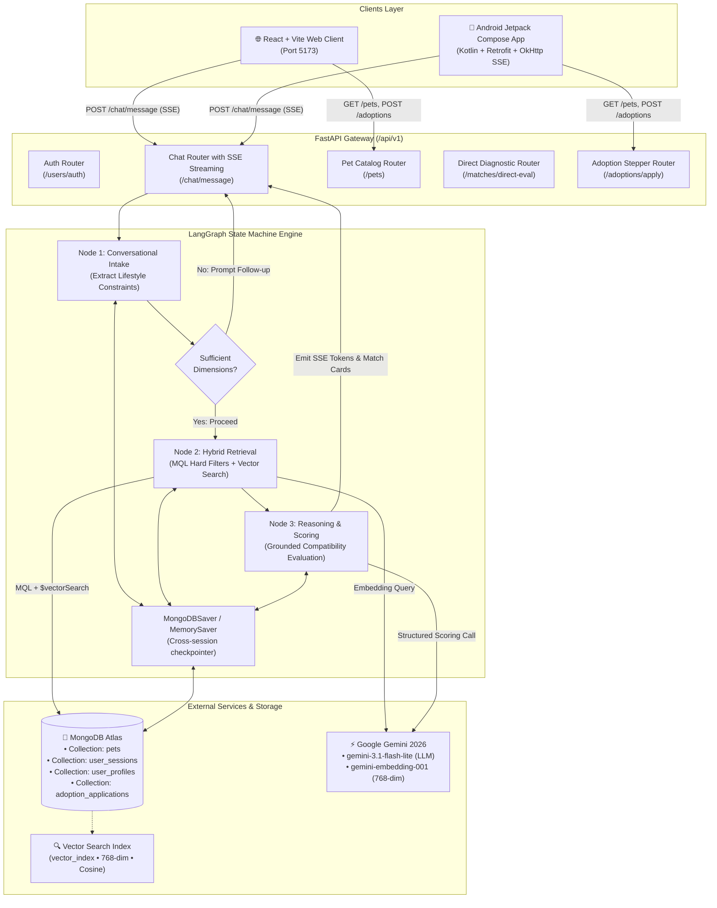

# 🐾 PawFect — AI-Powered Pet Matchmaker

> An intelligent, conversational pet adoption platform that matches prospective pet parents with shelter animals based on verified lifestyle compatibility rather than impulse picking.

[](https://fastapi.tiangolo.com)
[](https://langchain-ai.github.io/langgraph/)
[](https://www.mongodb.com/atlas/database)
[](https://ai.google.dev/)
[](https://react.dev/)
[](https://vitejs.dev/)
[](https://tailwindcss.com/)
[](https://developer.android.com/jetpack/compose)

---

## 📌 Table of Contents
1. [Overview & Value Proposition](#-overview--value-proposition)
2. [How PawFect Works (Architecture & Engine)](#-how-pawfect-works)
3. [Key Features](#-key-features)
4. [Project Directory Structure](#-project-directory-structure)
5. [Prerequisites](#-prerequisites)
6. [Quickstart: How to Run on Any Host](#-quickstart-how-to-run-on-any-host)
   - [Step 1: Clone & Configure Secrets](#step-1-clone--configure-secrets)
   - [Step 2: Setup MongoDB Atlas Vector Search Index](#step-2-setup-mongodb-atlas-vector-search-index)
   - [Step 3: Setup & Run FastAPI Backend](#step-3-setup--run-fastapi-backend)
   - [Step 4: Seed Database with Shelter Pets](#step-4-seed-database-with-shelter-pets)
   - [Step 5: Run the Web Frontend (React + Vite)](#step-5-run-the-web-frontend-react--vite)
   - [Step 6: Run Native Android App (Optional)](#step-6-run-native-android-app-optional)
7. [Deploying to Production / Cloud Hosts](#-deploying-to-production--cloud-hosts)
   - [Option A: Linux VPS (Ubuntu / Debian / AlmaLinux)](#option-a-linux-vps-systemd--nginx)
   - [Option B: Containerized Deployment (Docker Compose)](#option-b-containerized-deployment-docker-compose)
   - [Option C: Cloud Platform PaaS (Render / Railway / Fly.io)](#option-c-cloud-platform-paas)
8. [API Reference & Telemetry](#-api-reference--telemetry)
9. [Troubleshooting & FAQ](#-troubleshooting--faq)

---

## 📖 Overview & Value Proposition

Traditional pet adoption catalogs rely on static photo browsing and emotional impulse decisions. This frequently leads to mismatches between a pet's energy/exercise needs and the adopter's physical space, work hours, or family dynamics—contributing to heartbreaking shelter returns.

**PawFect** solves this with an **AI-First Matching Architecture**:
1. **Conversational Intake:** Users interact with an empathetic AI adoption counselor to share their living conditions (housing type, presence of children, resident pets, daily work schedule, energy preferences).
2. **Hybrid Retrieval:** Filters candidates using strict operational constraints (MongoDB Query Language) and searches candidate bio narratives with 768-dimensional cosine vector similarity.
3. **Grounded Explainable Scoring:** The reasoning engine evaluates candidate alignment at low temperature (`0.1`), generating transparent **0–100% compatibility scores**, specific **Pros**, and realistic **Caveats**.
4. **End-to-End Adoption Stepper:** Walk adopters through four structured milestones (*Match → Review → Apply → Adopt*).

---

## 🧠 How PawFect Works



### The 3 Core LangGraph Nodes
1. **Conversational Intake Node:** Ingests user input, updates dialogue history, and maps conversation context into a structured `LifestyleConstraints` schema (species, housing, children, pets, energy level).
2. **Hybrid Retrieval Node:** Executes MongoDB Query Language (MQL) pre-filtering (e.g. `housing_requirement == "apartment"`, `good_with_kids == true`) combined with a vector similarity search comparing query embeddings against pre-computed 768-dimensional pet bio embeddings.
3. **Reasoning & Scoring Node:** Analyzes candidate pet dossiers against user constraints using Gemini with strict grounding prompts (`temperature=0.1`). Outputs explainable compatibility scores (0–100%), evidence-based pros, and realistic caveats.

---

## ✨ Key Features

- **AI-First Mandatory Intake:** Users are gently guided to chat with the AI counselor first to establish a baseline before exploring the catalog.
- **Real-Time Token Streaming (SSE):** Chat responses stream word-by-word with typing indicators and quick-reply suggestion chips.
- **Fail-Safe Client Architecture:** The web frontend includes high-quality bundled sample pets and a resilient client-side watchdog timer, ensuring zero downtime even during backend cold starts.
- **Grounded Compatibility Scoring:** Every recommendation details why a pet matches and highlights potential friction points (e.g. exercise requirements, sensitivity to thunder).
- **Interactive Lifestyle Diagnostics:** Slide and adjust parameters (energy budget, housing, children) in real time to re-evaluate scores.
- **4-Stage Adoption Stepper:** Form submission with persistent status tracking (*Match → Review → Apply → Adopt*).
- **Adopter Profile Hub:** Manages home parameters, tracks saved favorites, and monitors application status.
- **Dual Native & Web Experience:** Fully implemented in both responsive React 18 and native Kotlin Jetpack Compose with Material 3.

---

## 📂 Project Directory Structure

```text
PawFect/
├── backend/                             # Python FastAPI & LangGraph Backend
│   ├── app/
│   │   ├── config.py                    # Environment settings (Pydantic Settings)
│   │   ├── main.py                      # FastAPI application entrypoint & CORS
│   │   ├── database/
│   │   │   ├── connection.py            # Async (Motor) & Sync (PyMongo) clients
│   │   │   └── indexes.py               # Vector Search index creation helpers
│   │   ├── models/                      # Pydantic v2 schemas
│   │   │   ├── pet.py                   # Pet document schema (768-dim embedding)
│   │   │   ├── user_profile.py          # Adopter profile schema
│   │   │   ├── user_session.py          # Session & history schema
│   │   │   ├── match_evaluation.py      # Compatibility score schema
│   │   │   └── adoption_application.py  # 4-stage application schema
│   │   ├── routers/                     # REST API & SSE endpoints
│   │   │   ├── chat.py                  # POST /chat/message (SSE + JSON)
│   │   │   ├── pets.py                  # GET /pets, GET /pets/{id}
│   │   │   ├── matches.py               # POST /matches/direct-eval
│   │   │   ├── adoptions.py             # POST /adoptions/apply, GET status
│   │   │   └── users.py                 # Auth & favorites (/users/favorite/...)
│   │   ├── services/                    # Core AI & LangGraph Services
│   │   │   ├── state.py                 # MatchmakerState TypedDict schema
│   │   │   ├── embedding.py             # Google Gemini 768-dim embeddings
│   │   │   ├── llm.py                   # Gemini 3.1 Flash-Lite LLM client
│   │   │   ├── retrieval.py             # Hybrid MQL + Vector Search engine
│   │   │   ├── nodes.py                 # LangGraph nodes (Intake, Retrieval, Scoring)
│   │   │   └── graph.py                 # StateGraph builder with MongoDBSaver
│   │   └── scripts/
│   │       └── seed_pets.py             # Seeds 36 shelter pets with live embeddings
│   ├── requirements.txt                 # Pinned backend dependencies
│   └── .env.example                     # Environment template
│
├── frontend/                            # React + Vite + Tailwind Web Client
│   ├── src/
│   │   ├── components/
│   │   │   ├── Navbar.jsx               # Navigation bar with auth status
│   │   │   ├── ChatCounselor.jsx        # Streaming conversational UI & match cards
│   │   │   ├── PetCard.jsx              # Responsive pet card with score badge
│   │   │   ├── PetDetailModal.jsx       # Comprehensive pet profile modal
│   │   │   ├── CompatibilityModal.jsx   # Live parameter adjustment diagnostic
│   │   │   ├── AdoptionModal.jsx        # 4-stage adoption application modal
│   │   │   ├── AuthModal.jsx            # Sign in & create account dialog
│   │   │   └── CircularGauge.jsx        # SVG circular score gauge (0-100%)
│   │   ├── data/
│   │   │   └── samplePets.js            # Bundled fallback shelter pets catalog
│   │   ├── services/
│   │   │   └── api.js                   # REST API client & SSE stream reader
│   │   ├── App.jsx                      # App root, state management & tab routing
│   │   ├── index.css                    # Tailwind CSS directives
│   │   └── main.jsx                     # Vite mount point
│   ├── package.json                     # Node dependencies
│   ├── tailwind.config.js               # Theme configuration
│   └── vite.config.js                   # Dev server & API proxy configuration
│
├── android/                             # Native Android Jetpack Compose Client
│   ├── app/src/main/
│   │   ├── java/com/pawfect/app/
│   │   │   ├── data/                    # DTOs, Retrofit service & OkHttp SSE client
│   │   │   ├── di/                      # Hilt Dependency Injection modules
│   │   │   ├── ui/screens/              # 8 Jetpack Compose screens
│   │   │   └── MainActivity.kt          # Single-activity Compose host
│   │   └── AndroidManifest.xml          # Permissions & network security
│   ├── build.gradle.kts                 # Gradle build scripts
│   └── gradle/libs.versions.toml        # Version catalog
│
├── .gitignore                           # Git ignore rules (protects .env, build artifacts)
└── README.md                            # Comprehensive documentation
```

---

## 📋 Prerequisites

Before running PawFect on any machine or host, ensure you have:

| Tool | Recommended Version | Purpose |
|---|---|---|
| **Python** | 3.10, 3.11, or 3.12 | Backend runtime (FastAPI & LangGraph) |
| **Node.js** | 18.x or 20.x LTS | Web frontend runtime & package manager |
| **npm** or **yarn** | 9.x+ | Frontend package installation |
| **MongoDB Atlas** | Free Tier (M0) or higher | Database & Vector Search index |
| **Google Gemini API Key** | Free or Pay-as-you-go | Generative AI & 768-dim embeddings |
| **Git** | 2.30+ | Repository version control |
| **Android Studio** *(Optional)* | Ladybug / Koala | For running the Android mobile client |

---

## 🚀 Quickstart: How to Run on Any Host

Follow these steps to run PawFect on your local computer, a virtual machine, or a dedicated server.

### Step 1: Clone & Configure Secrets

```bash
# 1. Clone repository
git clone https://github.com/Dhruva2607/Pawfect.git
cd Pawfect

# 2. Configure environment file for backend
cp backend/.env.example backend/.env
```

Open `backend/.env` in any text editor and provide your MongoDB URI and Gemini API key:

```ini
MONGODB_URI=mongodb+srv://<username>:<password>@cluster0.xxxxx.mongodb.net/?retryWrites=true&w=majority
DATABASE_NAME=pawfect_db
GOOGLE_API_KEY=AIzaSy...your_gemini_api_key...
HOST=0.0.0.0
PORT=8000
DEBUG=True
```

> **🔑 How to get free API keys:**
> - **Google Gemini API Key:** Visit [Google AI Studio](https://aistudio.google.com/) → *Get API key* (free).
> - **MongoDB Atlas:** Visit [MongoDB Atlas](https://www.mongodb.com/cloud/atlas) → Create a free M0 cluster → *Database Access* (create user) → *Network Access* (allow IP `0.0.0.0/0` or current host) → *Connect* (copy connection string).

---

### Step 2: Setup MongoDB Atlas Vector Search Index

In your MongoDB Atlas Web Console:
1. Navigate to **Atlas Search & Vector Search** under your cluster.
2. Click **Create Search Index**.
3. Select **JSON Editor** under **Atlas Vector Search**.
4. Choose Database: `pawfect_db` and Collection: `pets`.
5. Enter the exact Index Name: `vector_index`.
6. Paste the following index definition:

```json
{
  "fields": [
    {
      "type": "vector",
      "path": "embedding",
      "numDimensions": 768,
      "similarity": "cosine"
    },
    {
      "type": "filter",
      "path": "species"
    },
    {
      "type": "filter",
      "path": "size"
    },
    {
      "type": "filter",
      "path": "good_with_kids"
    },
    {
      "type": "filter",
      "path": "good_with_other_pets"
    },
    {
      "type": "filter",
      "path": "housing_requirement"
    }
  ]
}
```
7. Click **Next** → **Create Search Index**. Index creation typically takes 1–2 minutes.

---

### Step 3: Setup & Run FastAPI Backend

#### On Windows (PowerShell):
```powershell
cd backend

# Create virtual environment
python -m venv .venv
.\.venv\Scripts\activate

# Install dependencies
pip install -r requirements.txt

# Run FastAPI with live reload
uvicorn app.main:app --host 0.0.0.0 --port 8000 --reload
```

#### On Linux / macOS (Bash):
```bash
cd backend

# Create virtual environment
python3 -m venv .venv
source .venv/bin/activate

# Install dependencies
pip install -r requirements.txt

# Run FastAPI with live reload
uvicorn app.main:app --host 0.0.0.0 --port 8000 --reload
```

Verify backend is healthy:
- Open your browser or curl: [http://localhost:8000/health](http://localhost:8000/health)
- Interactive API Docs (Swagger): [http://localhost:8000/docs](http://localhost:8000/docs)

---

### Step 4: Seed Database with Shelter Pets

In a new terminal window (with the virtual environment active):

```bash
cd backend
python -m app.scripts.seed_pets
```

**Expected output:**
```text
Connecting to MongoDB Atlas at pawfect_db...
Connected to MongoDB pawfect_db.
Generating 768-dim embeddings for 36 pets via gemini-embedding-001...
[1/36] Embedded Buddy (dog) - 768 dims
[2/36] Embedded Luna (dog) - 768 dims
...
[36/36] Embedded Cleo (cat) - 768 dims
Successfully seeded 36 pets with live embeddings into MongoDB Atlas!
```

---

### Step 5: Run the Web Frontend (React + Vite)

In a separate terminal window:

```bash
cd frontend

# Install npm dependencies
npm install

# Start Vite development server
npm run dev
```

Open **[http://localhost:5173](http://localhost:5173)** in your browser!

> **💡 Note on API Proxying:**
> Vite's development server automatically proxies all `/api` requests to `http://localhost:8000` (configured in `frontend/vite.config.js`). If your backend is hosted on a remote server or different port, set `VITE_API_URL=https://your-api-domain.com/api/v1` in `frontend/.env`.

---

### Step 6: Run Native Android App (Optional)

1. Open **Android Studio** (Ladybug or Koala recommended).
2. Click **Open** and select the `PawFect/android` directory.
3. Allow Gradle to sync dependencies (`libs.versions.toml`).
4. In `android/app/src/main/java/com/pawfect/app/di/NetworkModule.kt`:
   - For Android Emulator, `http://10.0.2.2:8000/api/v1/` is already pre-configured to reach your host machine's backend.
   - For a Physical Phone over Wi-Fi, change `10.0.2.2` to your computer's local LAN IP (e.g., `http://192.168.1.100:8000/api/v1/`).
5. Select an Emulator (Android 14/15) or physical device and click **Run (Shift + F10)**.

---

## 🌐 Deploying to Production / Cloud Hosts

### Option A: Linux VPS (Systemd + Nginx)

For deployment on any cloud virtual server (DigitalOcean, Linode, AWS EC2, Hetzner, GCP Compute Engine):

#### 1. Backend Service (`/etc/systemd/system/pawfect-backend.service`)
```ini
[Unit]
Description=PawFect FastAPI Backend
After=network.target

[Service]
User=www-data
WorkingDirectory=/var/www/pawfect/backend
Environment="PATH=/var/www/pawfect/backend/.venv/bin"
EnvironmentFile=/var/www/pawfect/backend/.env
ExecStart=/var/www/pawfect/backend/.venv/bin/uvicorn app.main:app --host 127.0.0.1 --port 8000 --workers 4
Restart=always

[Install]
WantedBy=multi-user.target
```

Enable and start the service:
```bash
sudo systemctl daemon-reload
sudo systemctl enable --now pawfect-backend
```

#### 2. Build Frontend for Production
```bash
cd /var/www/pawfect/frontend
npm install
npm run build
# Builds static production files to /var/www/pawfect/frontend/dist
```

#### 3. Nginx Reverse Proxy Configuration (`/etc/nginx/sites-available/pawfect`)
```nginx
server {
    listen 80;
    server_name your-domain.com;

    # Static Frontend
    root /var/www/pawfect/frontend/dist;
    index index.html;

    location / {
        try_files $uri $uri/ /index.html;
    }

    # Backend API & SSE Streaming
    location /api/ {
        proxy_pass http://127.0.0.1:8000;
        proxy_http_version 1.1;
        proxy_set_header Connection '';
        proxy_set_header Host $host;
        proxy_set_header X-Real-IP $remote_addr;
        proxy_set_header X-Forwarded-For $proxy_add_x_forwarded_for;
        proxy_set_header X-Forwarded-Proto $scheme;

        # Disable buffering for SSE streaming
        proxy_buffering off;
        proxy_cache off;
        chunked_transfer_encoding on;
    }
}
```

Enable site & test:
```bash
sudo ln -s /etc/nginx/sites-available/pawfect /etc/nginx/sites-enabled/
sudo nginx -t
sudo systemctl reload nginx
```

---

### Option B: Containerized Deployment (Docker Compose)

Create a `docker-compose.yml` in the root directory:

```yaml
version: '3.8'

services:
  backend:
    build:
      context: ./backend
      dockerfile: Dockerfile
    restart: always
    environment:
      - MONGODB_URI=${MONGODB_URI}
      - DATABASE_NAME=pawfect_db
      - GOOGLE_API_KEY=${GOOGLE_API_KEY}
      - HOST=0.0.0.0
      - PORT=8000
    ports:
      - "8000:8000"

  frontend:
    build:
      context: ./frontend
      dockerfile: Dockerfile
    restart: always
    ports:
      - "80:80"
    depends_on:
      - backend
```

#### Backend `backend/Dockerfile`:
```dockerfile
FROM python:3.11-slim
WORKDIR /app
COPY requirements.txt .
RUN pip install --no-cache-dir -r requirements.txt
COPY . .
EXPOSE 8000
CMD ["uvicorn", "app.main:app", "--host", "0.0.0.0", "--port", "8000"]
```

#### Frontend `frontend/Dockerfile`:
```dockerfile
FROM node:20-alpine AS build
WORKDIR /app
COPY package*.json ./
RUN npm install
COPY . .
RUN npm run build

FROM nginx:alpine
COPY --from=build /app/dist /usr/share/nginx/html
COPY nginx.conf /etc/nginx/conf.d/default.conf
EXPOSE 80
CMD ["nginx", "-g", "daemon off;"]
```

Run with:
```bash
docker compose up --build -d
```

---

### Option C: Cloud Platform PaaS

- **Render / Railway / Fly.io:**
  - Create a new Web Service pointing to `backend/`.
  - Set Environment Variables: `MONGODB_URI`, `GOOGLE_API_KEY`, `DATABASE_NAME`.
  - Build command: `pip install -r requirements.txt`.
  - Start command: `uvicorn app.main:app --host 0.0.0.0 --port $PORT`.
  - Create a Static Site service pointing to `frontend/`, setting `VITE_API_URL` to your backend URL.

---

## 📡 API Reference & Telemetry

Interactive OpenAPI documentation is generated automatically by FastAPI at `/docs` or `/redoc`.

| Method | Endpoint | Description | Query / Body Parameters |
|---|---|---|---|
| `GET` | `/health` | Server health check & service status | None |
| `POST` | `/api/v1/chat/message` | AI Matchmaker conversation (supports JSON or SSE token streaming) | `{ "session_id": "...", "message": "...", "stream": true }` |
| `GET` | `/api/v1/pets` | List shelter pets with operational filters | `?species=dog&size=medium&good_with_kids=true&limit=50` |
| `GET` | `/api/v1/pets/{id}` | Retrieve individual pet document by ID | `id: str` |
| `POST` | `/api/v1/matches/direct-eval` | Live compatibility evaluation between user profile and a pet | `{ "pet_id": "...", "housing_type": "...", "energy_budget": 3 }` |
| `POST` | `/api/v1/adoptions/apply` | Submit 4-stage adoption application | `{ "user_id": "...", "pet_id": "...", "housing_details": "..." }` |
| `GET` | `/api/v1/adoptions/{id}/status`| Track adoption application stage and checklist | `id: str` |
| `POST` | `/api/v1/users/auth/login` | Sign in existing user or demo adopter | `{ "email": "...", "password": "..." }` |
| `POST` | `/api/v1/users/auth/signup` | Create user profile with lifestyle preferences | `{ "email": "...", "name": "...", "housing_type": "..." }` |
| `POST` | `/api/v1/users/{id}/favorite/{petId}` | Toggle pet favorite status (heart button) | `id: str, petId: str` |
| `GET` | `/api/v1/users/{id}/saved-pets` | List favorited pets for user | `id: str` |

---

## 🛠️ Troubleshooting & FAQ

#### 1. Why are pets not showing in the catalog?
- Ensure the FastAPI server is running on port `8000` and the database has been seeded using `python -m app.scripts.seed_pets`.
- The web frontend includes a bundled fallback catalog of 10 shelter pets (`samplePets.js`) that displays even if the backend is temporarily offline.

#### 2. Chatbot appears stuck or doesn't stream tokens:
- Verify that your `GOOGLE_API_KEY` is valid and has access to Gemini models.
- The web client includes a built-in 7-second safety watchdog. If network connectivity stalls, the counselor automatically completes intake and presents matched recommendations.

#### 3. How does vector search work without high latency?
- Pet embeddings are pre-computed (768 dimensions) during the seeding process and indexed in MongoDB Atlas.
- When an adopter's lifestyle is analyzed, only a single embedding call is made for the synthesized search query, followed by Atlas native indexing with cosine distance calculation.

#### 4. Can I use a different LLM or embedding model?
- The model resolution in `backend/app/services/llm.py` dynamically resolves the fastest active Gemini model (defaults to `gemini-3.1-flash-lite`).
- Embeddings use `gemini-embedding-001` with `output_dimensionality=768` to align with the Atlas vector index specification.

---

## 📄 License
This project is open-source under the MIT License. Built with ❤️ for shelter animals everywhere.
